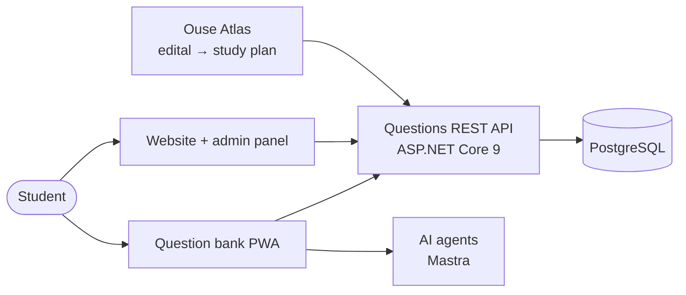

## João Pedro Brunet

**Developer at Ouse Passar** — an EdTech that prepares students for Brazil's public-service exams.
I work on the platform students study on every day, and on the systems the company runs behind it.

João Pessoa, Brazil · [LinkedIn](https://www.linkedin.com/in/joaopedrobrunet/)

---

### Ouse Passar — the platform

A TypeScript monorepo that holds the whole student-facing product:

- **Question bank PWA** — where students practice exam questions, installable on mobile.
- **Website + admin panel** — public site and the internal panel that manages content and students.
- **AI agents** — orchestration layer for the platform's AI features.
- **Ouse Atlas** — AI agent that reads an exam notice (*edital*) and builds a study track and a day-by-day schedule with linked questions, adapting to each student's performance. `FastAPI` `Claude API` `pgvector`

`TypeScript` `React` `Node.js` `ASP.NET Core` `PostgreSQL`

---

### OuseFlow CRM — sole developer

I'm the **only developer** on Ouse Passar's sales CRM, from database to UI.

Leads reach the company through WhatsApp and Instagram; sellers answer those conversations inside a kanban funnel.
The CRM stores which exam each lead is aiming for, so when a new exam is announced the team can reactivate
people who said "not now" months earlier.

- Migrated the whole system off Supabase to our own stack: Postgres with Row Level Security, auth (bcrypt + JWT), signed-URL file storage and transactional email.
- WhatsApp integration through a separate Node service (Baileys).

`Python` `FastAPI` `PostgreSQL` `Next.js 15` `TypeScript` `Docker`

---

### Also built at Ouse Passar

| | |
|---|---|
| **Ouse Access** | Credential vault for the whole company — AES-256-GCM encryption, view audit trail, password rotation history. |
| **Sales Script AI** | Sales playbook with AI objection handling and a role-play trainer that scores sellers. |
| **Back-office RPA** | Desktop automation that replaced a manual student-enrollment flow in the admin panel. |

---

Computer Science at UNIESP · Java / OOP teaching assistant · Company repositories are private — happy to walk through the architecture in a call.
